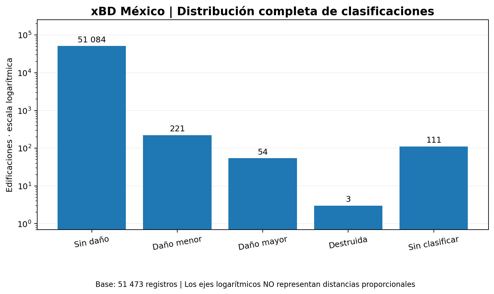
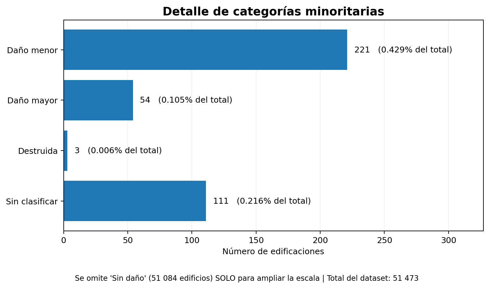
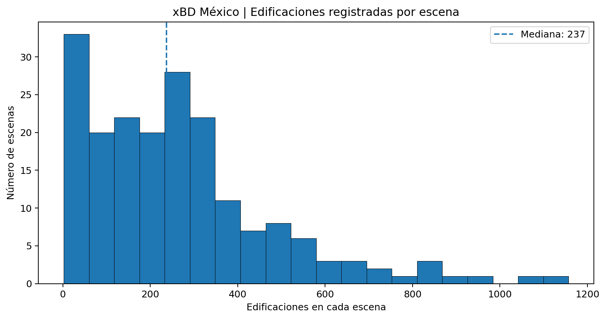
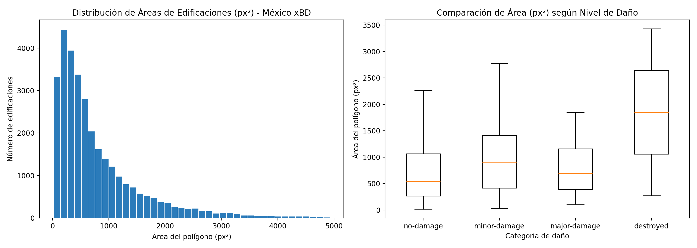
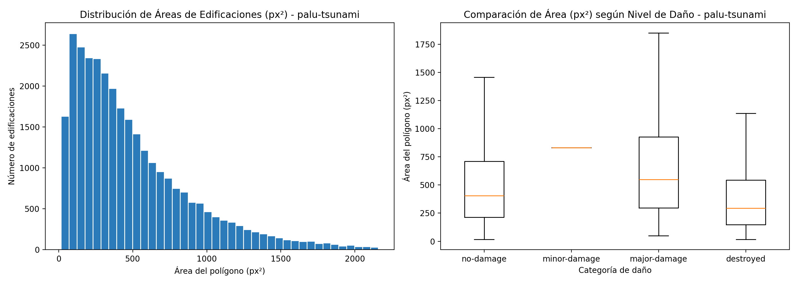
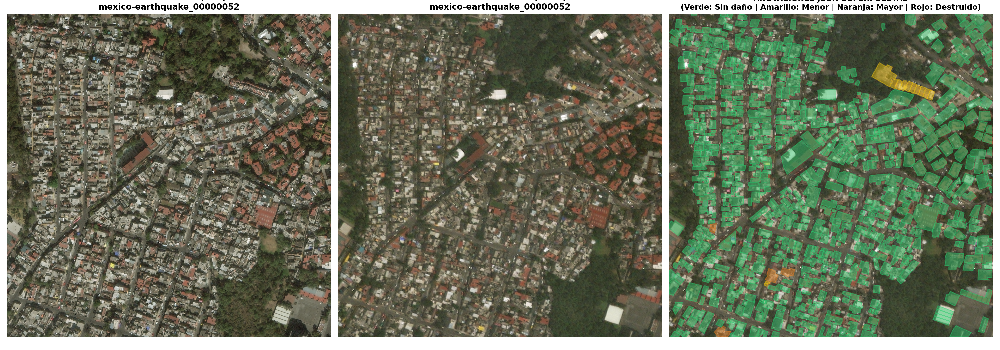
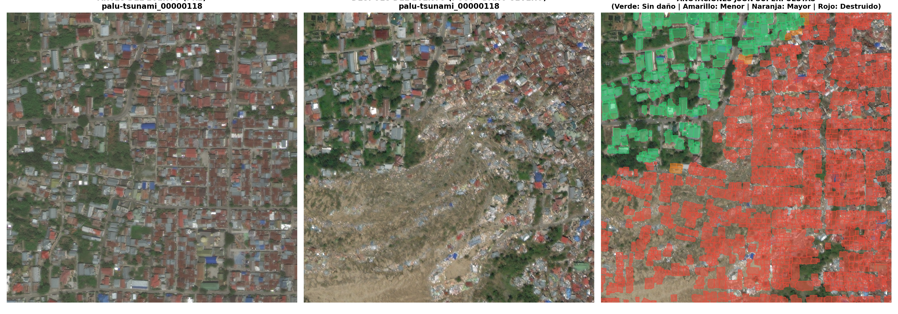

<div align="center">

# 📑 INFORME DE TRABAJO N.° 2
## 🛰️ Análisis exploratorio de datos y plan algorítmico

### Evaluación rápida de daño estructural post-sismo mediante imágenes satelitales


**Asignatura:** Aplicaciones de IA en Estructuras  
**Docente:** Ing. Kurt Walter Soncco Sinchi  
**Grupo 04**

**Integrantes:** Jhon Héctor Aire Artezano · Kevin Flores Paniura · Katherine Limaymanta Caballero · Jairo Paredes Mercado

</div>

---

> [!IMPORTANT]
> **Tarea 2.** Se presentan los resultados de validación y análisis exploratorio del evento `mexico-earthquake` del dataset xBD, así como el plan algorítmico para la clasificación de daños.

## 📌 Contenido

- [I. Análisis exploratorio de datos (EDA)](#i-análisis-exploratorio-de-datos-eda)
- [II. Plan algorítmico](#ii-plan-algorítmico)
- [III. Métricas de evaluación](#iii-métricas-de-evaluación)
- [IV. Principios PCS](#iv-principios-pcs)
- [V. Próximas actividades](#v-próximas-actividades)
- [VI. Referencias](#vi-referencias)

---

# I. Análisis exploratorio de datos (EDA)

## 🎯 1.1. Objetivo

Explorar y validar las anotaciones de edificaciones correspondientes al terremoto de México de 2017, con el fin de identificar inconsistencias, describir la distribución de daños y establecer los requerimientos para el modelado posterior.

El análisis se realizó en **Python**, utilizando `pandas` y `matplotlib`.

## 🛰️ 1.2. Fuente y estructura de los datos

La fuente del estudio es **xBD / xView2**, un conjunto de imágenes satelitales anteriores y posteriores a desastres con anotaciones de edificaciones y niveles de daño [1]. Para esta etapa se trabajó con los registros identificados como `mexico-earthquake`.

El script de preparación del grupo procesó **193 archivos de anotaciones PRE y 193 POST** y verificó los identificadores de edificaciones de ambos momentos. La tabla consolidada contiene **51 473 filas** distribuidas en **193 escenas**.

**Campos disponibles en el CSV actual:**

| Campo | Significado | Uso en la T2 |
|:--|:--|:--|
| `escena` | Identificador de la escena satelital | Agrupar los registros y evitar mezclar escenas entre particiones futuras |
| `uid` | Identificador de cada edificación | Revisar correspondencia y posibles duplicados |
| `clasificacion_dano` | Categoría de daño anotada | Estudiar frecuencias, desbalance y futura variable objetivo |

**Archivos de partida:** [tabla de edificaciones](01_Datos_Preparados/resultados/tabla_edificaciones.csv) · [validación de escenas](01_Datos_Preparados/resultados/validacion_escenas.csv) · [script de extracción](01_Datos_Preparados/scripts/validacion_dataset.py).

> [!NOTE]
> Los archivos PRE y POST contabilizados corresponden a **anotaciones JSON**. La revisión de imágenes satelitales y geometrías se realizará con los archivos originales.

## 🧹 1.3. Validación y limpieza de la tabla

Se aplicaron verificaciones de integridad a las columnas `escena`, `uid` y `clasificacion_dano`: valores vacíos, filas duplicadas, repetición de identificadores por escena, formato de identificadores y etiquetas diferentes de las categorías esperadas.

### 📋 Control de calidad del CSV

| Indicador comprobado | Resultado |
|:--|--:|
| Filas originales | **51 473** |
| Escenas únicas | **193** |
| Registros con campos vacíos | **0** |
| Filas duplicadas exactas | **0** |
| Registros con `uid` duplicado dentro de una escena | **0** |
| Escenas con formato inválido | **0** |
| `uid` con formato inválido | **0** |
| Etiquetas ajenas a las cinco esperadas | **0** |
| Registros `un-classified` | **111** |

No se detectaron inconsistencias en los campos evaluados. Los **111 registros** `un-classified` se separaron de las etiquetas conocidas, conservando el CSV original.

| Resultado de la separación | Registros |
|:--|--:|
| Edificaciones con categoría de daño conocida | **51 362** |
| Registros `un-classified`, reservados para revisión | **111** |
| Registros con errores detectados por la auditoría CSV | **0** |

**Evidencia:** [código de validación y limpieza](01_Datos_Preparados/scripts/validar_limpiar_edificaciones.py) · [reporte de auditoría](01_Datos_Preparados/resultados/resumen_auditoria.txt).

> **Alcance de la validación:** las comprobaciones realizadas corresponden a las tres columnas del CSV. La revisión de imágenes y polígonos se efectuará con los archivos originales.

## 📊 1.4. Resultados estadísticos del EDA

### 🏚️ Distribución de niveles de daño

| Clasificación original | Edificaciones | Porcentaje del total |
|:--|--:|--:|
| 🟢 `no-damage` — Sin daño | **51 084** | **99.2443 %** |
| 🟡 `minor-damage` — Daño menor | **221** | **0.4294 %** |
| 🟠 `major-damage` — Daño mayor | **54** | **0.1049 %** |
| 🔴 `destroyed` — Destruida | **3** | **0.0058 %** |
| ⚪ `un-classified` — Sin clasificar | **111** | **0.2156 %** |
| **Total** | **51 473** | **100 %** |

La categoría **sin daño representa más del 99 %** de los registros. Las clases de daño menor, mayor y destrucción están fuertemente subrepresentadas; esta desigualdad deberá considerarse en la selección del modelo y en las métricas de evaluación.

### 📈 Gráfico 1. Distribución completa de clasificaciones

<div align="center">



<sub>Figura 1. Frecuencias observadas de las cinco etiquetas. Se emplea una escala logarítmica para mostrar las categorías de menor frecuencia.</sub>

</div>

### 🔎 Gráfico 2. Detalle de las categorías minoritarias

<div align="center">



<sub>Figura 2. Detalle de las cuatro categorías de menor frecuencia, sin la barra «sin daño» para facilitar la lectura.</sub>

</div>

### 🏘️ Gráfico 3. Cantidad de edificaciones por escena

<div align="center">



<sub>Figura 3. Histograma de las 193 escenas del subconjunto de México.</sub>

</div>

| Indicador por escena | Valor |
|:--|--:|
| Escenas examinadas | **193** |
| Mediana de edificaciones por escena | **237** |
| Promedio aproximado de edificaciones por escena | **266.7** |
| Mínimo observado | **2** |
| Máximo observado | **1 157** |
| Escenas con al menos una edificación etiquetada con daño menor, mayor o destrucción | **47** |

Estos resultados evidencian variación en la cantidad de edificaciones anotadas por escena. Por ello, la futura división de los datos debe realizarse **por escenas**, evitando que edificaciones de una misma escena aparezcan tanto en entrenamiento como en prueba.

**Evidencia:** [script del EDA](01_Datos_Preparados/scripts/analisis_exploratorio.py) · [distribución de daño en CSV](01_Datos_Preparados/resultados/EDA/distribucion_eda.csv) · [conteo por escena](01_Datos_Preparados/resultados/EDA/edificaciones_por_escena.csv) · [resumen estadístico](01_Datos_Preparados/resultados/EDA/resumen_eda.txt).

## 🔍 1.5. Interpretación de los resultados y limitaciones

- **Desbalance extremo.** La abundancia de edificios sin daño puede favorecer modelos que predigan la clase mayoritaria, aunque identifiquen mal daños importantes.
- **Muy pocos casos destruidos.** Solo se identificaron **3 registros** `destroyed`. Se plantea ampliar la muestra con otros eventos de xBD antes de entrenar un clasificador de cuatro clases; con los datos actuales no es posible evaluar de forma confiable la categoría «destruida».
- **Etiquetas sin clasificar.** Los **111 casos** `un-classified` se mantienen documentados, pero no se usarían como ejemplos supervisados de las cuatro clases sin una revisión adicional.
- **Correlaciones.** El CSV actual solo contiene identificadores y categorías de daño; se requieren variables geométricas numéricas para analizar relaciones con el nivel de daño.


### 🖼️ 1.6. Análisis visual, geométrico e incorporación de evento con alta severidad (`palu-tsunami`)

Con los archivos originales `.png` y `.json` del dataset *xBD*, se ejecutó la verificación de pares PRE/POST, el cálculo de áreas de polígonos en píxeles cuadrados (px²) mediante geometrías WKT y la superposición visual de etiquetas. 

Además, atendiendo a la escasa presencia de daños severos en el evento `mexico-earthquake` (solo 3 edificaciones destruidas y 54 con daño mayor), se procesó e incorporó el evento sísmico y de tsunami **`palu-tsunami`** del mismo conjunto *xBD*, el cual presenta miles de edificaciones en las categorías `major-damage` y `destroyed`, permitiendo contrastar visual y estadísticamente escenarios de colapso masivo.

#### A. Verificación de integridad de imágenes satelitales originales (Pares PRE/POST)
Se comprobó que cada escena evaluada cuente con su par completo de imágenes satelitales (`_pre_disaster.png` y `_post_disaster.png`) y su archivo de anotaciones (`_post_disaster.json`):

* **Evento `mexico-earthquake`:** [`tabla_integridad_pares_pre_post.csv`](01_Datos_Preparados/resultados/tabla_integridad_pares_pre_post.csv) · [`resumen_integridad_mexico.csv`](01_Datos_Preparados/resultados/resumen_integridad_mexico.csv)
* **Evento `palu-tsunami` (Alto daño):** [`tabla_integridad_pares_palu-tsunami.csv`](01_Datos_Preparados/resultados/tabla_integridad_pares_palu-tsunami.csv) · [`resumen_integridad_palu-tsunami.csv`](01_Datos_Preparados/resultados/resumen_integridad_palu-tsunami.csv)

#### B. Extracción y revisión de geometrías JSON (Áreas en px²)
Se validaron las geometrías WKT (`features -> xy`) comprobando que los polígonos sean cerrados y válidos, extrayendo el área (px²) y perímetro (px) por nivel de daño:

* **Geometrías y áreas (`mexico-earthquake`):** [`edificios_geometrias_mexico.csv`](01_Datos_Preparados/resultados/edificios_geometrias_mexico.csv) · [`tabla_areas_por_clase.csv`](01_Datos_Preparados/resultados/EDA/tabla_areas_por_clase.csv)
* **Geometrías y áreas (`palu-tsunami`):** [`edificios_geometrias_palu-tsunami.csv`](01_Datos_Preparados/resultados/edificios_geometrias_palu-tsunami.csv) · [`tabla_areas_por_clase_palu-tsunami.csv`](01_Datos_Preparados/resultados/EDA/tabla_areas_por_clase_palu-tsunami.csv)

#### 📐 Gráfico 4. Distribución de áreas y comparación por nivel de daño (`mexico-earthquake` vs. `palu-tsunami`)


*Figura 4a. Distribución de áreas en px² y boxplot por categoría de daño en el evento `mexico-earthquake`.*


*Figura 4b. Distribución de áreas en px² y boxplot por categoría de daño en el evento `palu-tsunami`, con representación estadística robusta en las clases de daño mayor y destrucción.*

#### C. Visualización de ejemplos reales de edificaciones (PRE / POST + Anotaciones JSON)
A continuación, se contrasta una escena del sismo de México (predominio de estructuras sin daño visible) frente a una escena crítica del evento **`palu-tsunami`**, donde se aprecia claramente la destrucción estructural en la imagen POST y la correspondiente marcación de polígonos en rojo (`destroyed`) y naranja (`major-damage`):

#### 🛰️ Gráfico 5. Comparativa satelital PRE/POST y polígonos de daño superpuestos


*Figura 5a. Escena satelital del evento `mexico-earthquake` (predominio de polígonos verdes `no-damage` y casos puntuales de daño).*


*Figura 5b. Escena satelital de alto impacto del evento `palu-tsunami` mostrando el estado previo (PRE), la devastación posterior al evento (POST) y la superposición de anotaciones JSON con alta densidad de estructuras destruidas (rojo) y con daño severo (naranja).*
---

# II. Plan algorítmico

## 🤖 2.1. Problema de aprendizaje

Se plantea un problema de **clasificación supervisada de daño visible por edificación** a partir de dos recortes satelitales del mismo lugar: uno **pre-desastre** y otro **post-desastre**.

| Elemento | Propuesta para la T3 |
|:--|:--|
| **Entradas** | Par de imágenes RGB PRE/POST asociado a una edificación |
| **Etiqueta objetivo** | `no-damage`, `minor-damage`, `major-damage` o `destroyed` |
| **Unidad de predicción** | Edificación individual, representada por su par de recortes |
| **Salida** | Clase estimada y, cuando el modelo lo permita, probabilidades por categoría |
| **Tarea pendiente de preparación** | Crear los recortes a partir de imágenes y anotaciones originales |

**Flujo general propuesto:**

```text
Imagen PRE ─┐
            ├─► Recortes alineados del edificio ─► CNN ─► Clase de daño
Imagen POST ┘                                     │
                                                 └─► Probabilidades
```

## 🧠 2.2. Arquitecturas candidatas

Se compararán dos aproximaciones basadas en una CNN ligera, una vez preparados los pares de imágenes:

| Modelo candidato | Funcionamiento | Razón para incluirlo |
|:--|:--|:--|
| **A. ResNet18 con fusión temprana** | Une los canales RGB PRE y POST en una entrada de seis canales, adaptando la primera capa de la red. | Proporciona una referencia relativamente sencilla para aprender diferencias temporales. |
| **B. ResNet18 siamesa** | Procesa PRE y POST mediante dos ramas y combina sus características antes de clasificar. | Permite comparar explícitamente la información visual de ambos momentos, en línea con enfoques usados en daño satelital [3, 4]. |

La implementación se propone en **Python con PyTorch**, de acuerdo con los recursos disponibles del grupo. La selección definitiva dependerá de la preparación de recortes y del tamaño de los conjuntos de datos por clase.

## ⚙️ 2.3. Preparación y entrenamiento previstos

| Fase | Procedimiento propuesto | Estado |
|:--|:--|:--:|
| Verificación visual | Detectar pares PRE/POST incompletos, imágenes ilegibles y anomalías | ⏳ |
| Recortes por edificio | Extraer ventanas asociadas a los polígonos y alinearlas | ⏳ |
| Estandarización | Redimensionar los recortes y normalizar sus canales | ⏳ |
| Partición | Separar escenas completas en entrenamiento, validación y prueba | ⏳ |
| Desbalance | Ampliar la muestra, equilibrar lotes y comparar pérdidas ponderadas o focal loss **solo en entrenamiento** | ✅ Plan T2 |
| Entrenamiento | Comparar los dos modelos bajo un protocolo equivalente | T3 |

### ⚖️ Tratamiento del desbalance de clases

El conjunto de México presenta **51 084** edificios sin daño, **221** con daño menor, **54** con daño mayor y **3** destruidos. Para la siguiente etapa se establece este protocolo:

| Decisión | Aplicación prevista |
|:--|:--|
| **1. Ampliar los casos dañados** | Revisar otros eventos etiquetados de xBD e incorporar pares PRE/POST de las categorías minoritarias, registrando su evento de origen. |
| **2. Separar antes de equilibrar** | Dividir por **escenas o zonas completas** en entrenamiento, validación y prueba; impedir que edificios de una misma escena aparezcan en particiones distintas. |
| **3. Equilibrar el entrenamiento** | Reducir la frecuencia de ejemplos `no-damage` en los lotes y aumentar la selección de edificios dañados. Aplicar giros y reflejos idénticos a las imágenes PRE/POST del mismo par. |
| **4. Comparar funciones de pérdida** | Utilizar **cross-entropy ponderada** como referencia y compararla con **focal loss**, que da menor peso a ejemplos fáciles [5]. Calcular los pesos con los datos de entrenamiento y evitar valores extremos. |
| **5. Evaluar con datos no equilibrados** | Conservar validación y prueba con sus proporciones originales; informar **F1 macro**, **recall por clase** y matriz de confusión. |

**Viabilidad de cuatro clases.** Se mantendrá la clasificación original si, al ampliar los datos, cada categoría cuenta con suficientes casos para entrenar y evaluar de manera independiente. Si `destroyed` sigue representada por muy pocos ejemplos, se examinará una alternativa de **tres clases**: sin daño, daño menor y daño grave (`major-damage` + `destroyed`). En ese caso se documentará la agrupación y la pérdida de distinción entre daño mayor y destrucción.

> **Propuestas técnicas adicionales ante la escasez crítica de estructuras gravemente dañadas (`major-damage` y `destroyed`):**
> Además de ampliar la muestra con otros desastres de *xBD*, se incorporan tres mecanismos específicos para evitar el sobreajuste en las clases minoritarias:
> 1. **Muestreo estratificado por lote (`WeightedRandomSampler`) + Aumentación geométrica pareada:** En cada *mini-batch* de entrenamiento se forzará una proporción controlada de recortes con daño aplicando transformaciones idénticas al par PRE/POST (rotaciones ortogonales de 90°, 180°, 270°, espejado horizontal/vertical y variación fotométrica leve) exclusivamente sobre las clases minoritarias.
> 2. **Transfer Learning inter-sismo (Pre-entrenamiento multi-evento en xBD):** Pre-entrenar los pesos de las ramas ResNet18 utilizando eventos sísmicos y de colapso estructural con mayor densidad de destrucción en *xBD* (p. ej., *Palu Tsunami*, *Santa Rosa* o *Sunda Strait*), realizando luego un ajuste fino (*fine-tuning*) sobre el dominio constructivo de México.
> 3. **Clasificación jerárquica en dos etapas (Plan de contingencia para triaje):** Si la clase `destroyed` (3 casos locales) impide la convergencia en 4 clases puras, implementar un esquema jerárquico: **Etapa 1 (Filtro binario de daño):** *Sin daño* vs. *Con daño*; **Etapa 2 (Severidad estructural):** *Daño menor (Habitable)* vs. *Daño severo/Colapso (`major-damage` + `destroyed` — Inhabitable)*, priorizando maximizar el *Recall* de estructuras críticas en emergencias.

El **plan de tratamiento del desbalance está definido para la T2**. La ampliación de imágenes, el entrenamiento y la comparación de las técnicas se desarrollarán posteriormente.

El **plan de tratamiento del desbalance está definido para la T2**. La ampliación de imágenes, el entrenamiento y la comparación de las técnicas se desarrollarán posteriormente.

## 📌 2.4. Justificación técnica

El cambio entre imágenes satelitales anteriores y posteriores al desastre puede contener indicios visuales relacionados con daños. Las redes convolucionales permiten extraer patrones espaciales y las arquitecturas de dos entradas aprovechan la comparación temporal. El problema de evaluación de daños con xBD ha sido estudiado mediante modelos de localización y clasificación, incluidos enfoques de dos ramas y redes siamesas [1, 3, 4].

La predicción será una **clasificación preliminar de daño visible**, útil para orientar prioridades de revisión; no constituye una inspección estructural directa ni una comprobación de la seguridad de las edificaciones.

---

# III. Métricas de evaluación

La comparación de modelos se planificará sobre escenas **no usadas durante el entrenamiento**. Dado el desbalance observado, la exactitud global (**accuracy**) no será el único indicador.

| Métrica | ¿Qué representa? | ¿Por qué interesa? |
|:--|:--|:--|
| **F1-score macro** | Promedio del F1 de cada clase con el mismo peso | Evita que la clase mayoritaria domine la evaluación |
| **Recall por clase** | Proporción de casos reales de una clase que el modelo detecta | Especialmente importante para daños relevantes |
| **Precision por clase** | Proporción de predicciones de una clase que son correctas | Permite estudiar falsas alarmas |
| **Matriz de confusión** | Frecuencia de predicciones correctas y confusiones entre categorías | Identifica qué tipos de daño se mezclan |
| **Accuracy** | Proporción total de predicciones acertadas | Se informará únicamente como indicador complementario |

### ⚠️ ¿Por qué accuracy no basta?

Entre los **51 362 registros con etiqueta conocida**, hay **51 084** sin daño. Un sistema que siempre predijera «sin daño» obtendría aproximadamente **99.46 % de accuracy** sobre esos registros, pero no reconocería **ninguna** de las edificaciones con daño menor, mayor o destrucción. **El cálculo ilustra el efecto del desbalance, no el rendimiento de un modelo.**

**Criterio de evaluación:** priorizar el comportamiento por clase, especialmente los errores de clasificación en daños graves.

---

# IV. Principios PCS

El marco de **Veridical Data Science** propone considerar **Predictabilidad, Computabilidad y Estabilidad (PCS)** [2]. Para nuestro proyecto se vinculan con las siguientes decisiones:

| Principio | Aplicación en el Grupo 04 | Evidencia prevista |
|:--|:--|:--|
| 🎯 **P · Predictibilidad** | Evaluar si pares PRE/POST predicen el daño visible | F1 macro, recall por clase, matriz de confusión |
| 💻 **C · Computabilidad** | Mantener un flujo ejecutable de lectura, validación y modelado en Python | Scripts, archivos CSV, disponibilidad de imágenes y registro de recursos |
| 🛡️ **S · Estabilidad** | Comprobar sensibilidad al desbalance y a las particiones por escena | Variación de métricas y comparación de particiones/semillas cuando sea viable |

---

# V. Próximas actividades

| Actividad | Producto que se incorporará a este informe | Estado |
| :--- | :--- | :---: |
| Validación y separación de etiquetas del CSV | Script y resumen de auditoría | ✅ |
| EDA de daños y edificaciones por escena | Tres gráficos, dos CSV y resumen. | ✅ |
| Verificación de imágenes satelitales originales | Tabla de integridad de pares PRE/POST | ✅ |
| Extracción y revisión de geometrías JSON | Tabla de áreas y gráficos asociados | ✅ |
| Visualización de ejemplos de edificios | Imágenes reales con sus anotaciones | ✅ |
| Tratamiento del desequilibrio y viabilidad de cuatro categorías | Estrategia definida; Ampliación de los datos y número de clases para confirmar | ✅ |
| Plan de modelos, particiones y métricas. | Protocolo propuesto para la implementación de la T3 | ✅ |

## 🐍 Código y reproducibilidad

| Recurso | Enlace |
|:--|:--|
| Preparación y correspondencia de anotaciones | [`validacion_dataset.py`](01_Datos_Preparados/scripts/validacion_dataset.py) |
| Auditoría y separación de etiquetas | [`validar_limpiar_edificaciones.py`](01_Datos_Preparados/scripts/validar_limpiar_edificaciones.py) |
| Análisis exploratorio y gráficos | [`analisis_exploratorio.py`](01_Datos_Preparados/scripts/analisis_exploratorio.py) |
| Carpeta de resultados EDA | [`resultados/EDA`](01_Datos_Preparados/resultados/EDA) |

Para regenerar los resultados del EDA desde la **raíz del repositorio**, en un entorno con `pandas` y `matplotlib`:

```bash
pip install pandas matplotlib
python 01_Datos_Preparados/scripts/analisis_exploratorio.py
```

Este comando lee `tabla_edificaciones.csv` y guarda las salidas en `01_Datos_Preparados/resultados/EDA/`. El script no modifica la tabla fuente.

---

# VI. Referencias

1. **Gupta, R., et al. (2019).** *Creating xBD: A Dataset for Assessing Building Damage from Satellite Imagery*. CVPR Workshops. [Artículo](https://arxiv.org/abs/1911.09296) · [Dataset xView2](https://www.xview2.org/dataset).
2. **Yu, B., & Barter, R. (2024).** *Veridical Data Science*. MIT Press. [Libro](https://vdsbook.com/).
3. **DIU xView2.** *xView2 Baseline: Building Localization and Damage Classification*. [Repositorio de referencia](https://github.com/DIUx-xView/xView2_baseline).
4. **DIU xView2.** *First Place Solution for xView2*. [Repositorio con enfoque siamés](https://github.com/DIUx-xView/xView2_first_place).
5. **Lin, T.-Y., et al. (2017).** *Focal Loss for Dense Object Detection*. ICCV. [Artículo](https://arxiv.org/abs/1708.02002).

---

<div align="center">

<sub>🛰️ Grupo 04 · Aplicaciones de IA en Estructuras · Tarea 2</sub>

</div>
