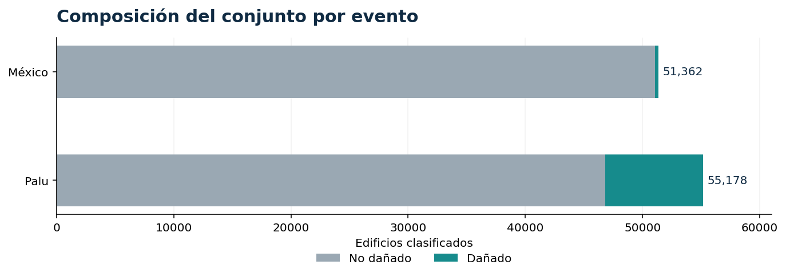
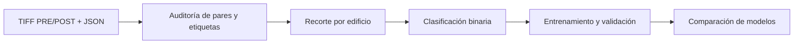
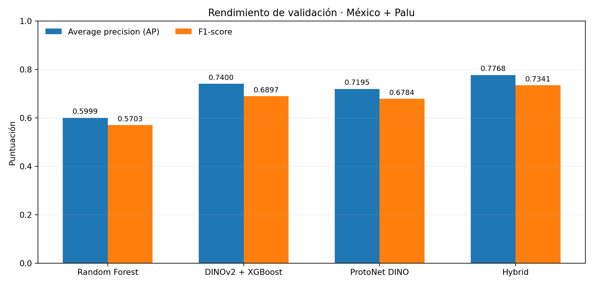
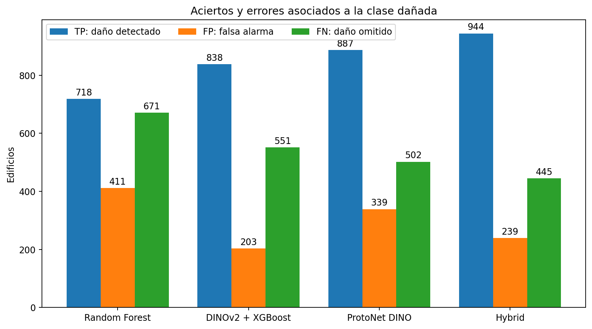
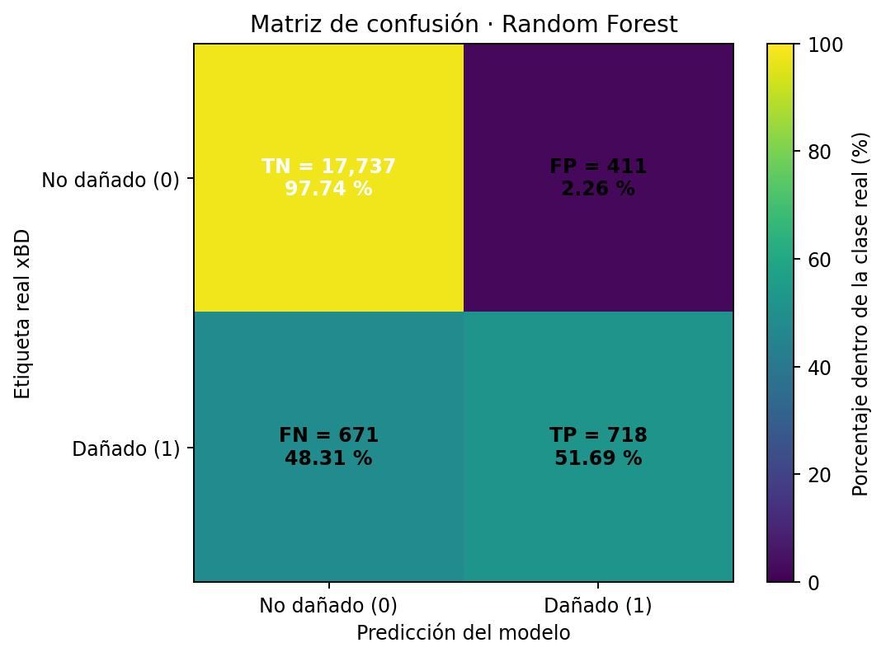
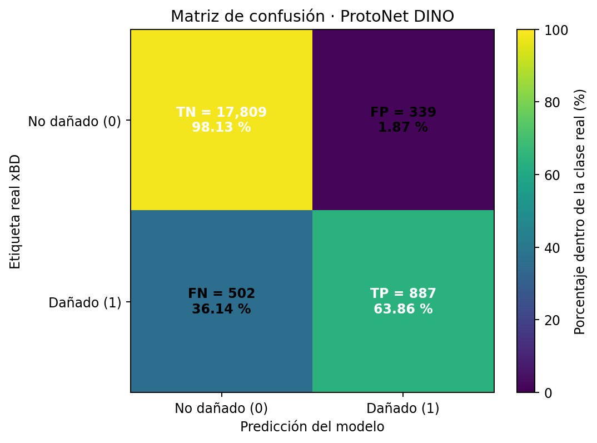
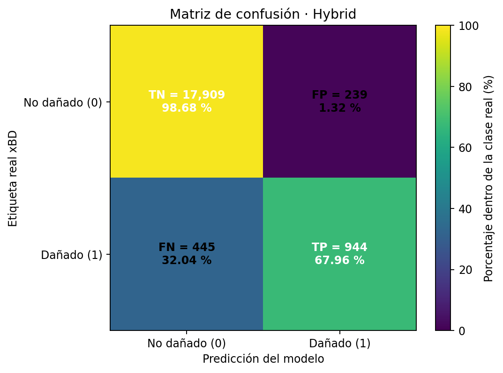

<div align="center">

# 🛰️ TF3 · Detección de daño visible en edificaciones

**Evaluación comparativa de modelos de inteligencia artificial con imágenes satelitales PRE/POST**


**Grupo 04 · Aplicaciones de IA en Estructuras**  
**Docente:** Ing. Kurt Walter Soncco Sinchi

</div>

---

## 📑 Contenido

1. [Objetivo y alcance](#objetivo)
2. [Datos y clasificación](#datos)
3. [Preparación y particiones](#metodologia)
4. [Modelos implementados](#modelos)
5. [Resultados de validación](#resultados)
6. [Discusión y limitaciones](#discusion)
7. [Código y documentación](#codigo)
8. [Bitácora de uso de IA](#bitacora-ia)
9. [Referencias](#referencias)

<a id="objetivo"></a>
## 🎯 1. Objetivo y alcance

Comparar métodos de aprendizaje automático y profundo para **identificar daño visible en edificaciones** a partir de pares de imágenes satelitales anteriores y posteriores a desastres naturales. El estudio integra dos eventos del conjunto xBD: el **terremoto de México** y el **tsunami de Palu**.

La salida es binaria: **0 = no dañado** y **1 = dañado (cualquier nivel de daño)**. Las predicciones corresponden a indicios visuales en imágenes; **no certifican la estabilidad ni la seguridad estructural** de una edificación.

El TF3 amplía el trabajo de exploración y validación desarrollado en TF2. Los archivos anteriores se conservan en [01_Datos_Preparados](../01_Datos_Preparados/) y [Presentacion](../Presentacion/), sin modificaciones.

<a id="datos"></a>
## 🛰️ 2. Datos y clasificación

Las imágenes y anotaciones originales están disponibles en [México](../data/mexico-earthquake/) y [Palu](../data/palu-tsunami/). Cada muestra de aprendizaje corresponde a un edificio identificado mediante polígono y asociado con sus recortes **PRE** y **POST**.

| Evento | Escenas utilizadas | No dañados | Dañados | Total | % dañados |
|:--|--:|--:|--:|--:|--:|
| México · terremoto | 192 | 51,084 | 278 | 51,362 | 0.54 % |
| Palu · tsunami | 193 | 46,796 | 8,382 | 55,178 | 15.19 % |
| **Total** | **385** | **97,880** | **8,660** | **106,540** | **8.13 %** |



### Correspondencia de etiquetas

| Categoría xBD | Variable binaria |
|:--|:--|
| `no-damage` | **0 · No dañado** |
| `minor-damage` | **1 · Dañado** |
| `major-damage` | **1 · Dañado** |
| `destroyed` | **1 · Dañado** |
| `un-classified` | Excluido |

En las anotaciones originales se identificaron **97,880** edificios `no-damage`, **222** `minor-damage`, **1,232** `major-damage` y **7,206** `destroyed`. Se excluyeron **722** anotaciones `un-classified` al carecer de una clase válida. Las 389 escenas PRE/POST inicialmente localizadas se redujeron a **385 escenas con anotaciones utilizables**.

<a id="metodologia"></a>
## 🧹 3. Preparación y particiones



La preparación se realizó en **CIMLAB AI**, mediante verificación de pares de imagen, etiquetas y polígonos, seguido de recortes por edificio. La versión **v0.5.4** restauró las particiones originales sin volver a generar las imágenes.

### Tratamiento de imágenes TIFF y recortes PRE/POST

Las imágenes de ambos eventos se descargaron mediante **Git LFS** y se verificó que fueran archivos TIFF reales, no punteros de descarga. En el conjunto utilizado, los TIFF contienen imágenes **RGB de tres canales (1024 × 1024 píxeles)**, almacenadas con datos de tipo `int16`. Como los valores observados de las imágenes verificadas se encontraban dentro del intervalo **0–255**, se incorporó un lector que comprueba el rango de cada archivo y convierte los canales a `uint8` de forma **exacta**, sin cambiar los valores de intensidad. La conversión permite procesarlas con las bibliotecas de visión artificial; **no aumenta la resolución, el contraste ni la nitidez**. Si un archivo tiene otro rango, el programa lo comunica en lugar de aplicar una normalización no verificada.

A partir de los polígonos anotados se definió una **misma ventana cuadrada PRE/POST para cada edificio**, con un margen de contexto de 12 píxeles y salida de **224 × 224 píxeles**. En una versión previa, las ventanas que sobrepasaban el límite de la imagen producían **franjas negras artificiales**, ajenas a la escena. La preparación utilizada en TF3 evita ese relleno negro: cuando una ventana excede el borde, completa la región externa mediante **reflexión de píxeles del borde** y descarta ventanas que están mayoritariamente fuera de la imagen. La reflexión no recupera información real ni representa daño; únicamente evita introducir bloques negros que podrían sesgar el aprendizaje. Los recortes se redimensionan mediante interpolación bilineal.

Se conservan las etiquetas originales, el identificador de edificio, la escena y el evento para auditoría. **No se aplicó una mejora generativa de imágenes ni se afirmó corregir automáticamente la desalineación o las diferencias de iluminación** entre fechas. Esos factores permanecen como limitaciones de la comparación satelital.

| Carpeta de origen | Partición | Escenas | No dañados | Dañados | Edificios |
|:--|:--|--:|--:|--:|--:|
| `tier1` | Entrenamiento | 231 | 57,521 | 5,668 | **63,189** |
| `hold` | Validación | 74 | 18,148 | 1,389 | **19,537** |
| `test` | Prueba reservada | 80 | 22,211 | 1,603 | **23,814** |
| **Total** | | **385** | **97,880** | **8,660** | **106,540** |

Los modelos se comparan en **validación**. El conjunto `test` se mantiene separado y no interviene en la selección de arquitectura ni umbral. El límite de negativos de entrenamiento se fijó en **0 (sin reducción)**, por lo que se usaron los 57,521 edificios no dañados de `tier1`.

<a id="modelos"></a>
## 🧠 4. Modelos implementados

| Enfoque | Modelo | Descripción |
|:--|:--|:--|
| Aprendizaje automático | **Random Forest** | Clasificación mediante árboles sobre características derivadas de pares PRE/POST. |
| Características profundas | **DINOv2 + XGBoost** | Extracción de características visuales preentrenadas y clasificador de árboles potenciados. |
| Aprendizaje por prototipos | **ProtoNet DINO** | Clasificación mediante representaciones visuales y prototipos de clase. |
| Combinación de modelos | **Hybrid** | Ensamble automático por promedio de probabilidades de los clasificadores con predicciones de validación disponibles. |

El modelo **Hybrid no constituye una red entrenada de forma independiente**. Su resultado depende de las predicciones disponibles cuando se genera. El archivo `hybrid_config.json` permite determinar los integrantes específicos de cada ejecución; esa composición no se ha adjuntado a este repositorio.

**ProtoNet DINO** dispone de métricas de validación registradas. **Hybrid** se actualizó automáticamente durante la comparación. La composición exacta del ensamble no está adjunta a esta entrega, por lo que no se atribuye su variación a un componente específico.

Se inició además un entrenamiento de **ResNet18 Early Fusion** con **20 épocas máximas** y **batch size = 8**. No se completó durante este corte de resultados y por ello **no participa en la tabla comparativa de modelos finalizados**.

<a id="resultados"></a>
## 📊 5. Resultados de validación · México + Palu

Las siguientes métricas corresponden a la validación conjunta de **19,537 edificios**. Fueron registradas en CIMLAB AI el **12 de noviembre de 2026**. No son resultados del conjunto de prueba.

| Modelo | AP | F1 | Recall | Precisión |
|:--|--:|--:|--:|--:|
| Random Forest | 0.5999 | 0.5703 | 51.69 % | 63.60 % |
| DINOv2 + XGBoost | 0.7400 | 0.6897 | 60.33 % | **80.50 %** |
| ProtoNet DINO | 0.7195 | 0.6784 | 63.86 % | 72.35 % |
| **Hybrid** | **0.7768** | **0.7341** | **67.96 %** | 79.80 % |



**Hybrid registró el mayor AP, F1 y recall de los cuatro resultados.** Frente a DINOv2 + XGBoost, su F1 aumentó en **0.0444** y el recall en **7.63 puntos porcentuales**, con una reducción de **0.70 puntos porcentuales** en precisión.

### Matrices de confusión · FP, FN, TP y TN

Para la validación conjunta (**19,537 edificios: 1,389 dañados y 18,148 no dañados**), se presentan los aciertos y errores de la clasificación binaria:

- **TP (verdadero positivo):** edificio dañado identificado como dañado.
- **FP (falso positivo):** edificio sin daño señalado erróneamente como dañado.
- **FN (falso negativo):** edificio dañado clasificado erróneamente como no dañado.
- **TN (verdadero negativo):** edificio sin daño identificado como no dañado.

| Modelo | TP | FP | FN | TN |
|:--|--:|--:|--:|--:|
| Random Forest | 718 | 411 | 671 | 17737 |
| DINOv2 + XGBoost | 838 | 203 | 551 | 17945 |
| ProtoNet DINO | 887 | 339 | 502 | 17809 |
| Hybrid | 944 | 239 | 445 | 17909 |

**Procedencia y alcance.** Los valores de **ProtoNet DINO** están confirmados en el registro de validación compartido (`TP=887`, `FP=339`, `FN=502`, `TN=17,809`). Para Random Forest, DINOv2 + XGBoost y Hybrid, los conteos se **reconstruyeron a partir de la precisión y el recall publicados con cuatro decimales**, y de la cantidad conocida de positivos/negativos de validación. Para cada modelo hay una única solución entera compatible con esos redondeos, y su F1 calculado coincide con el mostrado en CIMLAB AI. **No son una auditoría de predicciones por edificio**; esa verificación requeriría los CSV individuales exportados por la aplicación.



#### Random Forest



#### DINOv2 + XGBoost


#### ProtoNet DINO



#### Hybrid



En cada matriz, las filas representan la **etiqueta real** y las columnas la **predicción**. El porcentaje está normalizado por la clase real y la cifra corresponde al número de edificios.

Los gráficos detallados de los cuatro tipos de resultado de cada modelo se encuentran en [`resultados/figuras/`](resultados/figuras/). Los conteos agregados están en [`conteos_matriz_confusion_validacion.csv`](resultados/conteos_matriz_confusion_validacion.csv) y las figuras pueden reproducirse con [`graficar_matrices_confusion.py`](codigo/graficar_matrices_confusion.py).

### Seguimiento de ResNet18 Early Fusion

| Época | Pérdida de entrenamiento | AP de validación | F1 de validación |
|--:|--:|--:|--:|
| 1/20 | 0.2623 | 0.8135 | 0.7709 |
| 2/20 | 0.1927 | 0.7432 | 0.6662 |

Estos son **valores intermedios del registro de entrenamiento**, no métricas de un modelo finalizado. No se incluyen en el ranking anterior ni se afirma que exista un checkpoint final reproducible de ResNet18.

Los valores corresponden al último registro de validación de CIMLAB AI; no se incluyen archivos de predicción individuales ni la configuración específica del ensamble Hybrid.

El detalle de los resultados se conserva en [métricas de validación](resultados/metricas_validacion_preliminares.csv) y en el [registro de experimentos](resultados/REGISTRO_EXPERIMENTOS.md).

<a id="discusion"></a>
## 🔎 6. Discusión y limitaciones

Los modelos presentan diferencias entre precisión y sensibilidad: DINOv2 + XGBoost obtuvo la mayor precisión y Hybrid el mayor F1, AP y recall en validación. Sin embargo, la interpretación está condicionada por la distribución de los eventos: **Palu aporta 8,382 de los 8,660 edificios dañados (96.8 %)**. Por ello, un buen resultado agregado **no demuestra por sí solo un desempeño equivalente en México**.

También intervienen diferencias de resolución, iluminación, vegetación y geometría entre imágenes PRE/POST. Las herramientas de contraste y los mapas de diferencias pueden apoyar una revisión visual, pero no representan por sí mismos daño estructural. La conversión controlada a RGB `uint8` y el manejo de bordes se aplicaron para preparar recortes compatibles y evitar artefactos de relleno, no para reconstruir detalles faltantes.

**Alcance de esta entrega:** las métricas presentadas son de validación. No se dispone todavía de evaluación final de `test`, análisis cuantitativo separado por evento ni auditoría visual de casos individuales de falsos positivos/negativos; sí se presentan matrices de confusión agregadas. Estas verificaciones se proponen como continuación del estudio, sin atribuirles resultados no obtenidos.

<a id="codigo"></a>
## 💻 7. Código y documentación

| Recurso | Contenido |
|:--|:--|
| [Código fuente Python](codigo/cimlab_ai/) | Aplicación CIMLAB AI, preparación, entrenamiento, comparación y auditoría. |
| [Auditor del manifiesto](codigo/auditar_manifest.py) | Verificación independiente de etiquetas, duplicados y particiones. |
| [Guía de reproducibilidad](docs/GUIA_REPRODUCIBILIDAD.md) | Origen de datos, configuración y ejecución de scripts. |
| [Bitácora de uso de IA](docs/BITACORA_USO_IA.md) | Registro de solicitudes reformuladas, apoyos de ChatGPT y comprobaciones del equipo. |
| [Artículo técnico](docs/ARTICULO_IEEE_BORRADOR.md) | Texto académico con metodología, resultados y discusión. |
| [Versión LaTeX IEEE](docs/ARTICULO_IEEE_PLANTILLA.tex) | Fuente para edición y maquetación en IEEEtran. |
| [Tablas de resultados](resultados/) | Distribución y métricas registradas. |

El directorio incluye **scripts Python**, no modelos entrenados ni entornos virtuales. Los TIFF del repositorio se obtienen con **Git LFS**; los pesos de redes, los recortes locales y `manifest.csv` con rutas particulares se mantienen fuera de Git.

Para comprobar un manifiesto existente:

```bash
python TF3/codigo/auditar_manifest.py "RUTA/manifest.csv" --salida "resumen_manifest.json"
```

<a id="bitacora-ia"></a>
## 🧾 8. Bitácora de uso de inteligencia artificial

Durante el TF3 se utilizó **ChatGPT (OpenAI)** como apoyo para el diseño metodológico, la identificación de errores de la aplicación, la explicación de métricas, la revisión del procesamiento de imágenes y la organización de los entregables. Las decisiones sobre la clasificación binaria, los eventos incorporados y los entrenamientos ejecutados correspondieron al equipo.

La bitácora documenta **32 consultas representativas** agrupadas en cinco etapas: análisis inicial, adaptación a múltiples eventos, preparación técnica, entrenamiento y comparación, y comunicación académica. Cada registro contiene el **prompt reformulado**, la asistencia obtenida y la evidencia o comprobación disponible. Se presentan como **síntesis redactadas a partir de la conversación**, no como transcripciones literales.

| Etapa | Ejemplos de solicitudes realizadas | Evidencia del proyecto |
|:--|:--|:--|
| Diagnóstico inicial | Interpretar F1 bajo y revisar FP/FN con imágenes PRE/POST | Auditoría visual de validación |
| Datos multievento | Incorporar Palu y comprobar etiquetas binarias compatibles | Auditoría de 106,540 edificios |
| Preparación | Corregir lectura de TIFF RGB `int16`, bordes negros y particiones | Parches v0.5.3–v0.5.4 y manifiesto |
| Modelos | Comparar Random Forest, DINOv2, ProtoNet y Hybrid | [Métricas de validación](resultados/REGISTRO_EXPERIMENTOS.md) |
| Comunicación | Preparar artículo IEEE, README, gráficos y exposición | Documentos y figuras de TF3 |

**[Consultar la bitácora completa de uso de IA](docs/BITACORA_USO_IA.md)**

**Delimitación:** ChatGPT aportó explicaciones, propuestas de código y apoyo editorial; **los datos, ejecuciones, capturas y decisiones de aceptación fueron proporcionados o comprobados por el equipo**. Los resultados numéricos se basan en los registros de CIMLAB AI. El uso de IA no reemplaza la verificación experimental ni las referencias originales.

<a id="referencias"></a>
## 📚 9. Referencias

1. R. Gupta *et al.*, “xBD: A Dataset for Assessing Building Damage from Satellite Imagery”, 2019. https://arxiv.org/abs/1911.09296
2. xView2, “Dataset and Challenge”. https://www.xview2.org/
3. DIU, “xView2 Baseline”. https://github.com/DIUx-xView/xView2_baseline
4. B. Yu y R. Barter, *Veridical Data Science*. MIT Press, 2024. https://vdsbook.com/

---
<div align="center"><sub>Grupo 04 · TF3 · Resultados de validación registrados el 12 de noviembre de 2026</sub></div>
