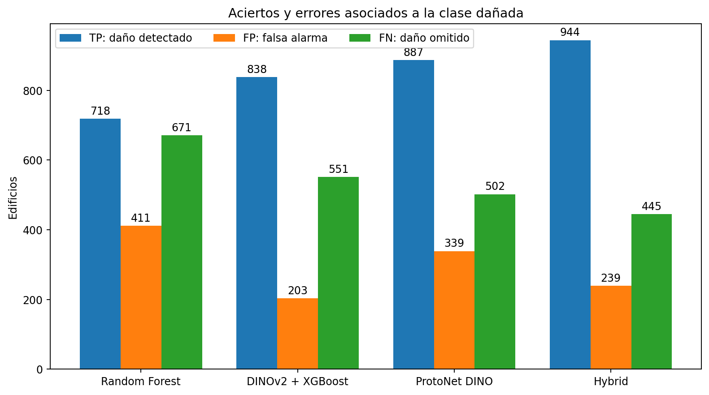

# Detección binaria de daños visibles en edificaciones a partir de imágenes satelitales PRE/POST

**Estudio comparativo con datos del terremoto de México y el tsunami de Palu**  
**Grupo 04 — Aplicaciones de IA en Estructuras**

## Resumen

Se implementó un sistema para clasificar edificaciones como dañadas o no dañadas a partir de pares de imágenes satelitales anteriores y posteriores a desastres naturales. Se integraron datos del terremoto de México y del tsunami de Palu procedentes de xBD, con 106,540 edificios válidos en 385 escenas; 8,660 edificaciones presentan alguna etiqueta de daño. Se preservaron las particiones de origen y se compararon Random Forest, DINOv2 + XGBoost, ProtoNet DINO y un ensamble por promedio de probabilidades. Sobre la validación conjunta de 19,537 edificios, Random Forest obtuvo F1 = 0.5703 y AP = 0.5999; DINOv2 + XGBoost, F1 = 0.6897 y AP = 0.7400; ProtoNet DINO, F1 = 0.6784 y AP = 0.7195; y el ensamble, F1 = 0.7341 y AP = 0.7768. Estos resultados corresponden a validación y no constituyen una evaluación final de prueba. La concentración de edificios dañados en Palu impide interpretar el desempeño global como evidencia de generalización equivalente a ambos eventos.

**Palabras clave:** xBD, xView2, imagen satelital, daño visible, clasificación binaria, DINOv2, Random Forest.

## I. Introducción

La identificación preliminar de edificaciones afectadas después de un terremoto o un tsunami puede contribuir a priorizar inspecciones en territorios extensos. La comparación de imágenes anteriores y posteriores al evento ofrece una fuente de información para detectar cambios visibles, aunque la apariencia captada por satélite no permite determinar por sí sola la seguridad estructural de una construcción.

La dificultad del problema incluye la escasez relativa de edificios dañados, la variación entre eventos y las diferencias de iluminación, resolución y geometría. El presente estudio compara clasificadores sobre dos eventos con una tarea binaria común: presencia o ausencia de daño visible por edificio.

## II. Datos y metodología

### A. Fuente de datos

Se utilizó una selección del dataset xBD/xView2 correspondiente al terremoto de México y al tsunami de Palu [1]. Se contabilizaron 385 escenas utilizables y 106,540 edificios con etiquetas válidas. En México se registraron 51,362 edificios (278 dañados); en Palu, 55,178 (8,382 dañados).

Las categorías originales `minor-damage`, `major-damage` y `destroyed` se agruparon en la clase positiva **dañado (1)**; `no-damage` se consideró **no dañado (0)**. Se excluyeron 722 anotaciones `un-classified`. Esta recodificación persigue detectar cualquier daño visible y no establecer un nivel de severidad.

### B. Preparación de imágenes

El procedimiento comprende la descarga de TIFF mediante Git LFS, la revisión de pares PRE/POST y archivos JSON, y la identificación de edificios a partir de polígonos anotados. Los TIFF RGB presentan tres canales y dimensiones de 1024 × 1024 píxeles; en los archivos examinados se almacenaban como `int16` con valores en el intervalo 0–255. Se implementó una lectura que verifica el rango y convierte esos valores exactamente a `uint8`, sin alterar intensidades ni generar nueva información visual. Para cada edificio se definió la misma ventana cuadrada en PRE y POST, con 12 píxeles de contexto y redimensionamiento a 224 × 224 mediante interpolación bilineal. Cuando el recorte excede la imagen se utiliza relleno por reflexión de los píxeles del borde, en lugar de añadir franjas negras artificiales; se rechazan ventanas mayoritariamente externas. Este procedimiento reduce un artefacto de preparación, pero no corrige automáticamente desalineaciones ni mejora la resolución espacial. Los recortes por edificio se registran en un manifiesto con evento, escena, UID, etiqueta y rutas correspondientes.

### C. Separación del conjunto

Se conservaron las particiones de origen y la separación por escenas: `tier1` como entrenamiento (**63,189 edificios, 5,668 dañados**), `hold` como validación (**19,537 edificios, 1,389 dañados**) y `test` como prueba reservada (**23,814 edificios, 1,603 dañados**). La comparación presentada utiliza exclusivamente validación, sin usar la partición de prueba para elegir modelos o umbrales.

### D. Arquitecturas comparadas

Se implementaron **Random Forest**, **DINOv2 + XGBoost** y **ProtoNet DINO**, además de un ensamble **Hybrid** que promedia las probabilidades de daño de modelos con predicciones compatibles. ProtoNet DINO representa los edificios mediante características visuales y prototipos de clase. Sus métricas de validación fueron registradas junto a las de los otros modelos. Hybrid no es una arquitectura neuronal independiente. La composición precisa del ensamble debe registrarse al conservar la configuración de cada experimento.

Se inició adicionalmente **ResNet18 Early Fusion** con un máximo de 20 épocas y lotes de 8 edificios. Como el entrenamiento no estaba completado al cierre de los registros, sus métricas intermedias no se incluyen en la comparación de modelos finalizados.

### E. Trazabilidad del apoyo de herramientas de IA

Se empleó **ChatGPT (OpenAI)** como herramienta auxiliar para discutir alternativas de procesamiento, interpretar mensajes de error y métricas, y estructurar código, tablas y texto técnico. Para transparentar su uso, se elaboró una [bitácora de consultas](BITACORA_USO_IA.md) con **29 consultas técnicas representativas reformuladas**, sus objetivos, la asistencia recibida y la comprobación disponible. La bitácora recoge una selección temática de solicitudes y no constituye una transcripción literal ni exhaustiva del historial.

El equipo definió la clasificación de daño, seleccionó los eventos y ejecutó los entrenamientos localmente. Los conteos y métricas se tomaron de los registros de CIMLAB AI; cuando se reconstruyeron valores a partir de métricas redondeadas, esa condición se declara expresamente. Las recomendaciones de la herramienta se contrastaron con el manifiesto, el código y los errores observados. Esta asistencia no sustituye la validación con el conjunto reservado de prueba ni la evaluación independiente del desempeño.

## III. Diseño de evaluación

Se consideran **average precision (AP)**, **F1-score**, **recall** y **precisión** para la clase de daño. AP resume el comportamiento según distintos umbrales; F1 sintetiza el equilibrio entre precisión y recall en el umbral aplicado. Las métricas se calcularon sobre los 19,537 edificios de la validación conjunta. El conjunto test permanece reservado.

## IV. Resultados y discusión

**Tabla 1. Métricas verificadas de validación conjunta de México + Palu**

| Modelo | AP | F1 | Recall | Precisión |
|:--|--:|--:|--:|--:|
| Random Forest | 0.5999 | 0.5703 | 0.5169 | 0.6360 |
| DINOv2 + XGBoost | 0.7400 | 0.6897 | 0.6033 | 0.8050 |
| ProtoNet DINO | 0.7195 | 0.6784 | 0.6386 | 0.7235 |
| **Hybrid** | **0.7768** | **0.7341** | **0.6796** | 0.7980 |

El ensamble alcanzó el mayor F1, AP y recall. Respecto a DINOv2 + XGBoost, aumentó el F1 en 0.0444 y el recall en 0.0763, mientras que su precisión disminuyó en 0.0070. Este balance es relevante para detección preliminar, donde omitir un edificio dañado puede ser costoso, aunque la interpretación exige considerar también los falsos positivos.

### Análisis de errores y matrices de confusión

A partir de los conteos de clases y las métricas publicadas de validación, se reconstruyeron los siguientes resultados; para ProtoNet DINO se contrastaron con los conteos exactos mostrados por CIMLAB AI.

| Modelo | TP | FP | FN | TN |
|:--|--:|--:|--:|--:|
| Random Forest | 718 | 411 | 671 | 17737 |
| DINOv2 + XGBoost | 838 | 203 | 551 | 17945 |
| ProtoNet DINO | 887 | 339 | 502 | 17809 |
| Hybrid | 944 | 239 | 445 | 17909 |

Las cuatro matrices están disponibles en los resultados del repositorio: [Random Forest](../resultados/figuras/matriz_confusion_random_forest.png), [DINOv2 + XGBoost](../resultados/figuras/matriz_confusion_dinov2_xgboost.png), [ProtoNet DINO](../resultados/figuras/matriz_confusion_protonet_dino.png) y [Hybrid](../resultados/figuras/matriz_confusion_hybrid.png).

El modelo Hybrid presenta **445 falsos negativos** y **239 falsos positivos**, frente a **551** y **203** de DINOv2 + XGBoost. Hybrid recupera 106 edificios dañados adicionales, pero genera 36 falsas alarmas más. Estos resultados expresan el intercambio entre sensibilidad y precisión al umbral seleccionado en validación.

**Procedencia:** los valores de ProtoNet DINO se leyeron del registro de validación; para los otros modelos son soluciones enteras compatibles con los valores de precisión/recall redondeados a cuatro decimales y 1,389 casos positivos en validación. No se dispone de predicciones individuales que permitan asignar cada error a un edificio específico.

La marcada diferencia de prevalencia entre eventos constituye la principal limitación de la comparación. Del total de edificios dañados, **96.8 % pertenecen a Palu**. Un resultado global favorable puede reflejar principalmente el desempeño en el evento con mayor número de positivos. En consecuencia, las cifras no permiten afirmar una capacidad equivalente para terremotos y tsunamis.

En ResNet18 Early Fusion se observaron, durante el entrenamiento, AP = 0.8135 y F1 = 0.7709 en la época 1, y AP = 0.7432 y F1 = 0.6662 en la época 2. Estas mediciones son **intermedias**; no se dispone de un entrenamiento finalizado ni de un checkpoint final documentado para compararlo de manera equivalente.

No se ejecutó una evaluación final sobre `test` ni se cuantificó el desempeño separado por evento al cierre de los registros. Se recomienda realizar ambos análisis y revisar falsos positivos y falsos negativos para estimar la robustez del sistema.

**ProtoNet DINO y Hybrid.** ProtoNet DINO registró F1 = 0.6784 y AP = 0.7195. La última comparación registró Hybrid con F1 = 0.7341 y AP = 0.7768. La composición exacta del ensamble no se adjuntó, por lo que no se atribuye su variación a un componente particular.

## V. Conclusiones

1. Fue posible consolidar y preparar un conjunto multievento de 106,540 edificios con un esquema binario común de daño visible y particiones por escena, sin utilizar las etiquetas ambiguas.
2. En validación conjunta, DINOv2 + XGBoost mejoró el F1 y AP respecto a Random Forest; el ensamble Hybrid alcanzó los valores más altos del grupo comparado, con F1 = 0.7341 y AP = 0.7768.
3. La concentración de casos positivos en Palu limita la extrapolación de los resultados agregados a México o a otros desastres. La evaluación reservada de test y el análisis por evento quedan como pasos posteriores.
4. Las predicciones sirven como apoyo a la inspección preliminar de cambios visibles y no reemplazan un diagnóstico de ingeniería estructural.

## Referencias

[1] R. Gupta *et al.*, “xBD: A Dataset for Assessing Building Damage from Satellite Imagery,” 2019. https://arxiv.org/abs/1911.09296  
[2] xView2, “Dataset and challenge,” https://www.xview2.org/.  
[3] DIU, “xView2 Baseline,” https://github.com/DIUx-xView/xView2_baseline.  
[4] B. Yu y R. Barter, *Veridical Data Science*. MIT Press, 2024.
